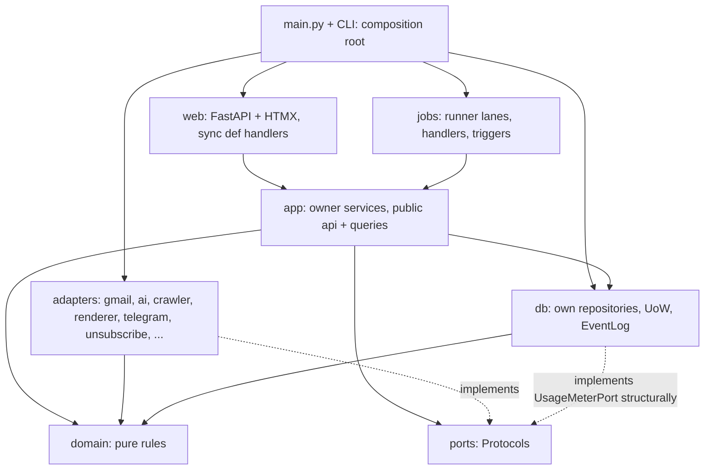
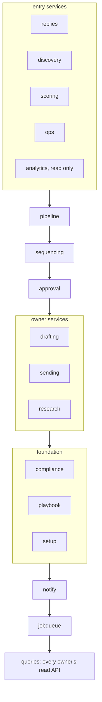
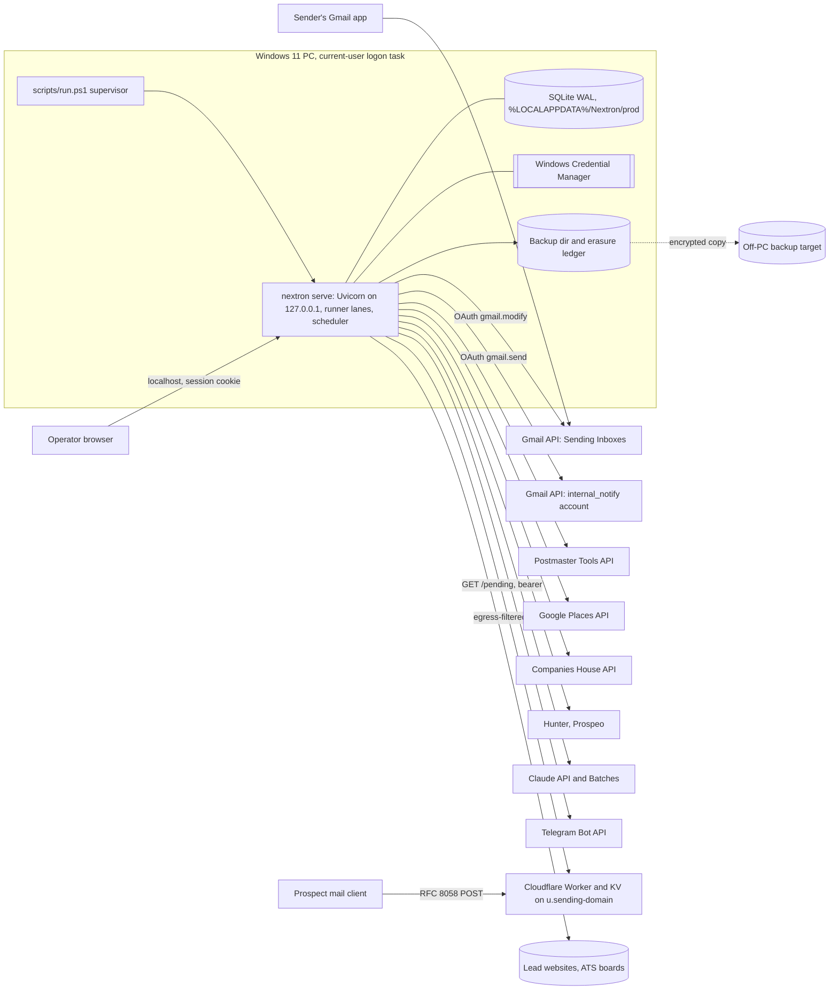
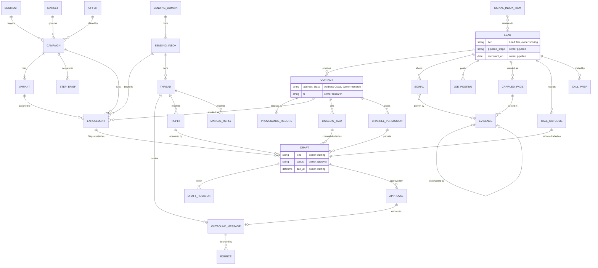
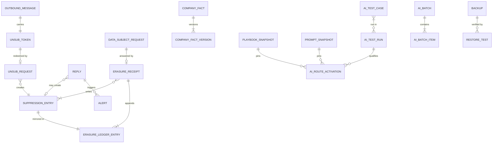
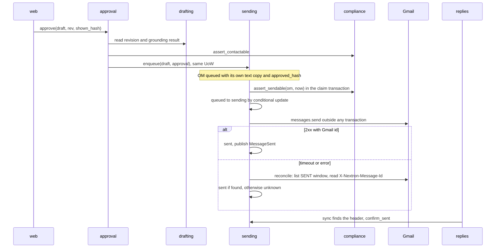

# Architecture Spine: Nextron Outreach Engine

## Design Paradigm

**A hexagonal modular monolith with a DB-backed job pipeline.**

- **Domain:** a pure core of entities, state machines and rules (Eligibility, contactability, send gate, Send Window, scoring, rendering, hashing). No I/O; functions take `now` as a parameter.
- **Application:** one service per owner (AD-3). Services own use cases and writes, reach the outside world only through **ports** (Python `Protocol`s) that **adapters** implement, and reach other owners only through those owners' public API.
- **Pipeline:** discovery → enrichment → scoring → enrollment → drafting → approval → sending → replies. Each stage is a durable job; the service that finishes a stage enqueues the next one in the same transaction (AD-10). Nothing is handed over in memory.
- **Delivery:** the dashboard, the job runner and the CLI are thin entry points over the same services, in **one OS process**. Each entry point owns its unit of work (AD-3).

| Layer | Package | May import |
|---|---|---|
| Domain | `nextron/domain/` | stdlib only. `zoneinfo` data comes from `tzdata`; the Public Suffix List is a vendored data file. |
| Ports | `nextron/ports/` | domain |
| Persistence | `nextron/db/` (`engine`, `uow`, `eventlog`, `repos/<owner>/`, `owners.py`, `pii_registry.py`, `metering`, `alembic/`) | domain, SQLAlchemy, python-ulid |
| Application: commands | `nextron/app/<owner>/` (public surface `api.py`) | domain, ports, `nextron.db.uow`, `nextron.db.eventlog`, **its own** `nextron.db.repos.<owner>`, any `nextron.app.queries.*`, and the `api` of owners **below it** in the app DAG. Never another owner's repositories. |
| Application: read API | `nextron/app/queries/<owner>.py` | domain, `nextron.db.repos.<owner>` |
| Adapters | `nextron/adapters/` (incl. `nextron/adapters/ai/`) | ports, domain, third-party SDKs |
| Delivery | `nextron/web/`, `nextron/jobs/` | `nextron.app.*.api`, `nextron.app.queries.*`, domain types |
| Composition root | `nextron/main.py`, `nextron/__main__.py` (CLI) | everything: wiring, the notification registry, startup checks |



**App DAG.** A box may call the `api` of any box below it; boxes in the same layer never call each other. Upward effects use the notifications in AD-3. Every service may import every `queries` module.



## Invariants & Rules

### AD-1: Layer and dependency rule [ADOPTED]
- **Binds:** all code.
- **Prevents:** I/O leaking into rules; delivery code calling SDKs or the DB; one owner reaching into another's tables; import cycles between services.
- **Rule:**
  - Imports follow the layer table and both diagrams. import-linter 2.16 (`include_external_packages = true`, `exclude_type_checking_imports = true`) enforces seven contract groups in CI:
    1. `layers`: `nextron.main` > `nextron.web | nextron.jobs | nextron.adapters` > `nextron.app` > `nextron.ports | nextron.db` > `nextron.domain`.
    2. `forbidden`: `nextron.web`, `nextron.jobs` → `nextron.adapters`, `nextron.db` (`allow_indirect_imports = true`).
    3. `forbidden`: `nextron.adapters` → `nextron.app`, `nextron.db`.
    4. `forbidden`: every non-adapter package → `anthropic`, `googleapiclient`, `google_auth_oauthlib`, `google`, `httpx2`, `playwright`, `keyring`, `cryptography`, `selectolax`, `trafilatura`, `protego`, `dns`, `email_validator`.
    5. `forbidden`: every package except `nextron.adapters.ai` → `anthropic`. Non-AI adapters are listed explicitly; each new adapter is added.
    6. `layers` over the app DAG: `replies | discovery | scoring | ops | analytics` > `pipeline` > `sequencing` > `approval` > `drafting | sending | research` > `compliance | playbook | setup` > `notify` > `jobqueue` > `queries` (all under `nextron.app`).
    7. Per-owner `forbidden`, generated from `nextron/db/owners.py`: `nextron.app.<x>` and `nextron.app.queries.<x>` → `nextron.db.repos.<y>` for every y ≠ x (`allow_indirect_imports = true`).
  - Third-party placement: `apscheduler` in `jobs`; `pydantic_settings` in `main`; `sqlalchemy` and `alembic` in `db`; `ulid` in `db` and `app`; `pydantic` in `app` and `adapters`; every SDK in contract 4 only in `adapters`.
  - `domain` imports nothing outside the stdlib. On Windows `tzdata` supplies the IANA data `zoneinfo` reads; that is a data dependency, not an import.

### AD-2: One process, one database, disciplined writes
- **Binds:** all persistence; the process model; deployment.
- **Prevents:** SQLite writer contention; two runners or schedulers; silently deferred transactions; schema forks between parallel stories.
- **Rule:**
  - One process per environment: `python -m nextron serve` runs Uvicorn (`workers=1`; `--reload` only in `dev`) hosting the dashboard, the runner threads (AD-10) and an APScheduler `AsyncIOScheduler`, all started and stopped in the FastAPI lifespan. Before starting the runner the process takes an exclusive OS lock on `<data dir>\nextron.lock`; if the lock is held it exits with code 3.
  - One SQLite file: WAL, `busy_timeout=5000`, `synchronous=NORMAL`, `foreign_keys=ON`. Only `nextron/db/engine.py` configures connections: a `connect` event sets `isolation_level=None` and a `begin` event emits `BEGIN IMMEDIATE`. A test asserts both.
  - Every write runs in the entry point's unit of work (AD-3). No transaction spans a network call: network work is prepare transaction → port call → apply transaction.
  - Startup refuses to run when `NEXTRON_ENV` is unset, `sqlite3.sqlite_version < 3.51.3`, `ZoneInfo("Europe/London")` fails, the data dir is inside a OneDrive folder, the dashboard port is taken, or the DB's Alembic revision is ahead of the code. When the revision is behind, startup takes a `pre_migrate` backup (AD-20) and runs `alembic upgrade head` before the runner starts.
  - Schema changes only through Alembic (`render_as_batch=True`), as one linear chain with revision ids `<NNNN>_<story-key>`. CI asserts a single head and that every model column appears in `owners.py` and `pii_registry.py`.
  - Nothing copies the live DB file (backups: AD-20).

### AD-3: Single owner per table and column group; one unit of work per entry point
- **Binds:** every table (owner map in *Structural Seed*); every `nextron/app` service; every entry point.
- **Prevents:** two services writing the same data under different rules; nested transactions that self-deadlock; import cycles; cross-owner effects that land minutes apart.
- **Rule:**
  - Each table, or column group of a shared table, has exactly one owning service. `nextron/db/owners.py` is the executable map, and a test fails on any unmapped column. Only the owner writes, through `nextron/db/repos/<owner>/`.
  - Other services read an owner's data only through `nextron.app.queries.<owner>` and change it only through `nextron.app.<owner>.api`, along the app DAG.
  - **Unit of work.** Each entry point (web request handler, job handler, CLI command) opens exactly one context-local UoW and calls one use-case method. Only that method may open `uow.transaction()` blocks, and a network call happens only between them. Every owner command it reaches, directly or through a notification, joins the open transaction and never begins, commits or rolls back. A command with nothing to do returns a no-op result; it raises only on an invariant violation, which rolls back the whole transaction.
  - **Notifications** carry effects that point up the DAG. The publisher calls `uow.publish(<Notification>)`; subscribers are owner commands registered only in `main.py` and run in the same transaction, before commit, in the order listed. This list is closed:

    | Notification | Publisher | Subscribers, in order |
    |---|---|---|
    | `SubjectSuppressed` | compliance | `sequencing.stop(suppressed)`; `approval.cancel_pending`; `pipeline.cancel_tasks`; `pipeline.close(lost)` when the source is an opt-out |
    | `ContactErased` | compliance | every owner's `erase_pii` named in `pii_registry` |
    | `LeadsMerged` | discovery | every owner's `reparent_lead` (the survivor keeps the more advanced stage) |
    | `MessageSent` | sending | `approval.on_sent`; `sequencing.on_step_sent`; `pipeline.advance_to_at_least(contacted)` for cold kinds |
    | `InboxRemoved` | sending | `sequencing.stop(inbox_removed)` |
    | `Enrolled` | sequencing | `pipeline.advance_to_at_least(queued)` |
    | `DraftRejected` | approval | `sequencing.stop(operator_rejected)` for a rejected Step Draft of any Step number ("skip" is not a rejection and doesn't stop); `pipeline.close(disqualified)` for "bad fit" when the Operator ticks it |
    | `EvidenceChanged` | research | `drafting.flag_stale` |
    | `EventClosed` | research | `approval.return_event_expired` |
    | `FooterChanged` | setup | `drafting.recompose_ready` |

  - `discovery.merge` is refused when both Leads have an `active` or `paused` Enrollment.
  - `events` (AD-4) is an audit log; no code reads it to trigger behaviour.
  - A story that needs a column in another owner's table gets it through that owner's story.

### AD-4: State machines are closed enums; transitions are recorded as events
- **Binds:** every status column; `events`; FR-21, FR-26–FR-28, FR-31, FR-32, FR-35, FR-37, FR-38, FR-40, FR-45, FR-54, FR-55, FR-63; SM-3, SM-6–SM-8, SM-11.
- **Prevents:** illegal transitions, such as sending a rejected Draft or reviving an opted-out Lead; status strings invented per story; Pipeline moves that roll back reply ingest; analytics that can't be rebuilt.
- **Rule:**
  - Each machine lives in `nextron/domain/<machine>.py`: status enum, event enum, cause enum and transition table. `transition(current, event) -> Transition(to, cause)` or raises `IllegalTransition`. No other module defines status strings.
  - Only the owner writes a status, and in the same transaction appends an `events` row through `db.eventlog.append`: `entity` (table name), `entity_id`, `from_status`, `to_status`, `cause` (the machine's enum), `cause_ref` (ULID of the triggering row), `actor` ∈ {`operator`, `sender`, `system:<service>`, `ai:<route>@<version>`, `seed`}, `at`. `events` never holds personal data and is never updated or deleted.

    | Machine | Owner | Statuses | Terminal | Who moves it |
    |---|---|---|---|---|
    | Lead Pipeline Stage | `pipeline` | `new`, `queued`, `contacted`, `replied`, `interested`, `call_booked`, `call_held`, `audit_proposed`, `audit_won`, `build_proposed`, `won`; parked `not_now`; closed `lost`, `disqualified` | `lost`, `disqualified` (Operator may reopen) | Automatic moves only via `advance_to_at_least(stage)`: a no-op (no event, no error) when the Lead is at or past `stage`, closed, or parked, except `not_now → interested` on a hot Reply and `not_now → queued` by `recontact_due`. `park_not_now(date)`. `close(lost or disqualified)` also stops Enrollments. `record_call_outcome` → `call_held`, or back to `call_booked` on a no-show. Every other move is the Operator's. |
    | Enrollment | `sequencing` | `active`, `paused`, `stopped`, `completed`. Pause cause ∈ {`inbound_pending`, `uncertain_class`, `operator`}. Stop cause ∈ {`reply`, `manual_reply`, `hard_bounce`, `suppressed`, `operator_stop`, `operator_rejected`, `lead_closed`, `inbox_removed`, `contact_erased`} | `stopped`, `completed` | `pause`: replies, Operator. `resume` only from `paused` with no stop since: Operator, or replies for `inbound_pending` when the class is Out of Office. `stop`: replies, notifications, pipeline, Operator. `completed`: `on_step_sent` after the last Step. |
    | Draft | `approval`; `drafting` inserts rows at `ready` | `ready`, `approved`, `sent`, `rejected`, `superseded`, `cancelled` | `sent`, `rejected`, `superseded`, `cancelled` | `ready → approved` (AD-6 checks). `approved → ready` (edit, expiry, Event expired). `ready` or `approved → rejected` (Operator). `approved → sent` (`MessageSent`). `ready` or `approved → superseded` (Manual Reply on the Thread). `ready` or `approved → cancelled` (stop and suppression cascades). Channel Drafts: `ready → sent` when the Operator logs the touch. |
    | OutboundMessage (OM) | `sending` | `queued`, `sending`, `sent`, `unknown`, `cancelled` | `sent`, `cancelled` | `queued → sending` (gate passed, conditional update). `sending → sent` (2xx with a Gmail id, or reconciliation or sync finds the header). `sending → unknown` (reconciliation finds nothing; restore). `unknown → sent` (sync finds the header, or Operator). `unknown → queued` or `cancelled` (Operator only). `queued → cancelled` (approval un-approves). Restore: `queued → unknown`. |
    | SendingInbox | `sending` | `connecting`, `active`, `paused`, `auth_failed`, `removed`. Pause cause ∈ {`operator`, `bounce_rate`, `policy_bounce`, `blocklist`, `spam_rate`} | `removed` | `connecting → active` (OAuth and identity check, AD-12). `active ⇄ paused`. `active` or `paused → auth_failed` (`invalid_grant`). `auth_failed → active` (re-consent). Any → `removed` (Operator; publishes `InboxRemoved`). FR-64 authentication and warm-up are gate predicates, not statuses. |
    | Reply | `replies` | `received`, `classified`, `needs_review`; `class_source` ∈ {`rule`, `model`, `operator`} | none | `received → classified` (rule match or model). `received → needs_review` (uncertain, refused, failed, or served by a fallback model). `needs_review → classified` (Operator). `classified → classified` (Operator override; a `rule` Unsubscribe changes only through `compliance.reverse_optout`). |

    | Supporting machine | Owner | Statuses and rules |
    |---|---|---|
    | Campaign | `setup` | `draft`, `active`, `paused`. A UK Campaign moves `draft → active` only with an LIA reference and date. |
    | Address Class | `research` | `published`, `guessed`, `verified`, `invalid`. `guessed → verified` (verification valid); `guessed → published` (found on the Lead's site); any → `invalid` (failed check or hard Bounce); `invalid` is terminal. CSV addresses start `guessed`. |
    | SuppressionEntry | `compliance` | `active`, `voided`. Voided only by `reverse_optout`, only for `source=reply_rule`. |
    | LinkedInTask | `pipeline` | `pending`, `sent`, `skipped`, `accepted`, `cancelled` |
    | SignalInboxItem | `discovery` | `pending`, `processed`, `flagged` |
    | Alert | `notify` | `pending`, `sent`, `unknown`, `failed` |
    | Job | `jobqueue` | `queued`, `running`, `done`, `dead` |

  - Draft flags are columns, not statuses: `grounding` per revision (`pending`, `pass`, `fail`), `generic`, `stale`, `event_expired`, `reapproval_required`, `skipped_at`. "Stalled" is derived (AD-21). The queue shows every due `ready` Draft whatever its flags; flags render as badges, and `fail` blocks approval.
  - **Analytics facts**, recorded from Slice 1 as owner columns: `approvals.review_ms`, `approvals.edit_ratio` (against revision 1) and `approval_sessions` (approval); the OM snapshot taken at enqueue (`tier`, `lead_score`, `variant_id`, `segment_id`, `market_id`, `inbox_id`, `step_no`, `kind`) (sending); `replies.om_id`, `replies.step_no`, `replies.hot` (replies); `daily_capacity` with signal shortfall (scoring); `crawl_runs` (research); `drafts.generic` (drafting); `call_outcomes` (pipeline; FR-69 Offer validation); `ai_usage`. FR-54 and FR-55 read `events` plus these columns and nothing else.

### AD-5: One send path, one gate, exactly-once delivery
- **Binds:** FR-18, FR-23, FR-31, FR-33–FR-38, FR-43, FR-50, FR-64, FR-65, FR-70; UJ-5; `app.sending`, `app.compliance`.
- **Prevents:** a send that skips a stop condition, suppression, cap or window; Reply Drafts held like cold Steps; a double send after a timeout, crash, sleep or restore.
- **Rule:**
  - Only `app.sending` calls `MailPort.send`, and only for an OutboundMessage. OM id = ULID, sent as `X-Nextron-Message-Id`. Internal mail never uses `MailPort` (AD-15).
  - **Message kinds** (on Draft and OM). Cold: `step` (Steps 1–4, including a referral Step 1 and an FR-63 restart) and `recontact` (FR-63 Not Now). Responsive: `reply` (FR-43, FR-66, the FR-67 thank-you) and `rebook` (FR-69). `channel` Drafts never become OMs. Only the gate and dispatch (AD-11) branch on kind.
  - **Gate.** `compliance.assert_sendable(om, now)` evaluates `domain.send_gate.PREDICATES` over facts read through owners' read APIs and returns every failing predicate. The list is closed:

    | Predicate | Kinds | Passes when |
    |---|---|---|
    | `contactable` | all | AD-16 allows the recipient on `email` |
    | `approval_live` | all | the Draft is `approved`, the OM's `approval_id` is its current approval, and `sending_policy.approval_expired(approved_at, now)` is false |
    | `hash_matches` | all | the hash of the OM's stored text equals `approved_hash` (AD-6) |
    | `inbox_ready` | all | Sending Inbox `active`, and its latest FR-64 check passed within 26 h |
    | `footer_complete` | all | the FR-23 fields for the recipient's Market are non-blank |
    | `market_eligible` | all | the recipient's Market is enabled; for cold kinds, `domain.eligibility.evaluate` (FR-18) passes live |
    | `enrollment_active` | cold | Enrollment `active` |
    | `thread_quiet` | cold | no inbound human message and no Manual Reply on the Thread after `approved_at` |
    | `campaign_active` | cold | Campaign `active`; UK: LIA reference and date recorded |
    | `in_send_window` | cold | the recipient's local time is inside the Send Window on a weekday |
    | `under_daily_cap` | cold | the inbox's cold sends today are below its ramped Daily Cap |
    | `warmup_ok` | cold | at least 14 days of recorded warm-up |
    | `under_total_ceiling` | cold | all SENT messages today, warm-up tool sends included, are below the total ceiling |

    Responsive kinds skip every cold row and go out at once (FR-34). A failing gate leaves the OM `queued` with `blocked_by`; the gate never cancels an OM or writes another owner's rows. A `hash_matches` failure also raises an ops alert.
  - **Flow**, one OM at a time per inbox (concurrency key `inbox:<id>`):
    1. *Prepare, no transaction:* pick the candidate (AD-11). A Step 1 citing a job posting last checked more than 24 h ago: enqueue `recheck_event` and skip it this tick. Responsive kinds: require a mailbox sync of the inbox completed after `approved_at`, else enqueue one and skip (FR-65). Refresh the access token and build the MIME (AD-22).
    2. *Claim transaction:* the gate passes, then `UPDATE … SET status='sending', send_started_at=now WHERE id=? AND status='queued'` must change exactly one row.
    3. `MailPort.send`, outside any transaction.
    4. *Apply:* a 2xx with a Gmail id → `sent` with `gmail_message_id` and `gmail_thread_id`; read back `Message-ID` via `messages.get(format=METADATA)` and store it as `rfc_message_id` (if that call fails, the next sync fills it); publish `MessageSent`. Any other outcome leaves the OM `sending` and the handler ends without retrying.
  - **Reconciliation** (`reconcile_sends`, at startup and every 2 min, for OMs `sending` for more than 2 min): list the inbox's `SENT` messages to the recipient `after:` (`send_started_at` − 120 s), fetch each with `format=METADATA` and headers `X-Nextron-Message-Id` and `Message-ID`, and match the ULID exactly. Found → `sent` with its ids. Not found → `unknown`. The `header:` and `rfc822msgid:` operators are not used unless the Gmail spike (*Open Questions*) proves them.
  - An `unknown` OM moves to `sent` when mailbox sync finds its header (AD-19); otherwise only the Operator resolves it on the health panel. Nothing re-queues automatically. After a restore every non-terminal OM becomes `unknown` (AD-20).

### AD-6: Approval is bound to the exact rendered message
- **Binds:** FR-21, FR-23, FR-25–FR-31, FR-43, FR-55, FR-65; UJ-1, UJ-2; `app.drafting`, `app.approval`, `app.sending`.
- **Prevents:** sending text nobody saw; two OMs for one Draft; approving a revision that changed after the card rendered; approving an ungrounded edit; expiry computed two ways.
- **Rule:**
  - Draft text lives in immutable `draft_revisions` (`draft_id`, `rev`, `subject`, `body`, `footer_snapshot_id`, `evidence_ids`, fact versions, `origin` ∈ {`generated`, `regenerated`, `operator_edit`, `footer_change`}, `text_hash`). Only `app.drafting` writes revisions; Operator edits reach it through `approval` → `drafting.revise`. `drafts.current_rev` points at the latest. Revision 1 keeps the AI's original text (FR-55).
  - `domain.render.compose(revision, footer_snapshot)` renders exactly what the prospect receives: subject and plain-text body with signature, footer and UK privacy line. The card shows this rendering. Footer settings are snapshotted when a revision is composed; `FooterChanged` recomposes `ready` Drafts only.
  - `domain.render.text_hash` = SHA-256 of UTF-8 (`to_address` + `"\n"` + `inbox_id` + `"\n"` + canon(subject) + `"\n\n"` + canon(body)), where canon = NFC, `\r\n` and `\r` → `\n`, trailing whitespace stripped per line, trailing blank lines stripped. Defined once; transport headers are outside the hash.
  - **Approve.** `approval.approve(draft_id, rev, shown_hash)` (batch approval applies it per item in one UoW) succeeds only if the Draft is `ready`, `rev` is current, grounding for that revision is `pass`, `shown_hash` equals the current hash, and AD-16 allows. Otherwise that item returns `stale` or `blocked` and the card re-renders. Edit-then-approve records a pending approval that completes when the new revision's grounding passes.
  - On success, in one UoW: insert an `approvals` row (`approval_id`, `draft_id`, `rev`, `text_hash`, `approved_by`, `approved_at`, `review_ms`); Draft → `approved`; call `sending.enqueue(draft, approval)`, which inserts exactly one `queued` OM holding its own copy of recipient, inbox, subject, body, `approved_hash` and the AD-4 snapshot. A partial unique index allows one `draft_id` among OMs that aren't `cancelled`. Sending reads only the OM copy, never the Draft.
  - **Un-approve.** An edit, reject, expiry, supersede or cascade on an `approved` Draft first calls `sending.cancel(om)`: from `queued` it cancels; on `sending` or `unknown` it raises and the action fails with "already sending". The Draft then returns to `ready` (edit, expiry, Event expired) or takes its terminal status.
  - **Expiry.** `domain.sending_policy.approval_expired(approved_at, now)` := `now ≥ approved_at + 72 h` is the only definition. `expire_approvals` (every 15 min) un-approves expired Drafts with `reapproval_required = true`.
  - Grounding is stored per revision. Operator edits are re-checked at `interactive` urgency and never batched.
  - A Manual Reply is the Sender's own approval (FR-65). The engine records it (AD-19) and never generates or sends one.

### AD-7: Evidence-first, immutable data
- **Binds:** FR-7, FR-8, FR-10–FR-16, FR-20–FR-22, FR-26, FR-31, FR-51, FR-61, FR-62, FR-68, FR-72; §5.6.
- **Prevents:** unsupported facts in a Draft; Evidence changing under an approved claim; Evidence type confused with source; Lead Tier computed two ways.
- **Rule:**
  - Every Signal, Lead fact and Contact attribute references at least one `evidence` row and a `provenance_record`. Evidence `type` ∈ {`quote`, `absence`, `count`} (a quote is at most 300 characters); `source` ∈ {`website`, `ats`, `registry`, `signal_inbox`, `csv`, `referral`, `operator`}; `extracted_by` ∈ {`ai:<route>@<version>`, `rule`, `operator`}. Absence and count Evidence record every page checked.
  - Only `app.research` writes Evidence, Signals and Provenance Records. Signal Inbox content becomes Quote Evidence with `source=signal_inbox` through `research.ingest_signal_item`.
  - AI extraction output is a proposal, stored only after the AD-18 code checks pass; otherwise it is discarded and an event recorded.
  - Evidence and Approved Company Facts are never updated or deleted, except erasure tombstones (AD-17). A changed observation inserts a new row and sets `superseded_by` on the old one; a vanished source sets `retracted_at`; an identical re-observation updates only `last_confirmed_at`. A fact edit inserts a new `(fact_id, version)`; each version carries its allowed Segments and Markets.
  - Revisions store `evidence_ids` and `(fact_id, version)` pairs. Prompts receive only the facts allowed for the Draft's Segment and Market. Grounding checks claims only against the revision's own set: first `domain.grounding_rules` (deterministic FR-4, FR-21 and Playbook §4 checks), then the `grounding_check` route. Call Prep Sheets are grounded the same way.
  - `domain.grounding.is_stale(revision, now)` is the only staleness test: a cited Evidence row is superseded or retracted, a cited fact version is not current or not allowed, or a cited Event is not live. `EvidenceChanged` flags `ready` Drafts `stale`, and `refresh_due_queue` regenerates them before they become due. An approved Draft is pulled back only when a cited Event closes (`EventClosed` → `event_expired`).
  - Lead Tier is computed only by `domain.scoring.tier(events, now)` and written only by `scoring`. Event age comes only from `domain.signals.age_days`: the event date when known, else first seen.

### AD-8: One AI gateway: routes, urgency, batches, refusals and budget [ADOPTED models]
- **Binds:** every Claude call; FR-8, FR-11, FR-20–FR-22, FR-25, FR-40, FR-43, FR-57, FR-66–FR-68, FR-71, FR-73.
- **Prevents:** ad-hoc models and prompts; batch requests rejected for carrying `fallbacks`; latency-bound work stuck in a 24-hour batch; refusals or truncated output crashing a route; the budget stopping essential paths.
- **Rule:**
  - Only `nextron/adapters/ai` imports `anthropic`. `LlmPort` has `run(route_tuple, inputs, urgency) -> LlmResult` (Messages API), `submit_batch(route_tuple, items) -> batch_id`, `fetch_batch(batch_id)` and `delete_batch(batch_id)`. No port call waits on a batch. `LlmResult` is one of `ok(parsed)`, `refused`, `truncated`, `invalid`, `failed(retryable)`, each carrying the model that served the call and its usage, including `iterations`.
  - `routes.py` declares candidate versions `{name, model, effort, prompt_version, output_schema, batchable, max_tokens}`. App services pass the *active* tuple from `ai_route_activations` (AD-12).

    | Route | Model | Budget class |
    |---|---|---|
    | `extract_signals`, `extract_people` | `claude-haiku-5-5` | blockable (enrichment) |
    | `signal_inbox_parse` | `claude-haiku-5-5` | blockable (discovery) |
    | `grounding_check` | `claude-haiku-5-5`; tested fallback `claude-opus-5-5` | never blocked |
    | `draft_sequence`, `draft_reply`, `draft_channel` | `claude-opus-5-5` | never blocked |
    | `classify_reply`, `call_prep` | `claude-opus-5-5` | never blocked |

  - **Urgency** is set per call: `interactive` (Operator regenerate, edit recheck), `soon` (the Signal Inbox chain, referrals, every Reply path, regenerating Drafts due within 24 h), `bulk` (scheduled enrichment; Step drafting for Enrollments due 24 h or more ahead). Only `bulk` calls on `batchable` routes use Message Batches.
  - **Batches.** Batch requests never carry `fallbacks`; a test asserts it. `custom_id` = `<route>_<target ULID>_<rev>`. `poll_ai_batches` runs every 15 min. The owner's `apply_<route>_result` re-checks that the target still needs the result, that its input fingerprint (cited Evidence ids, fact versions, route tuple) still matches, and that the subject is still contactable; otherwise the item is `stale`. Refused, errored and expired items are re-run as direct calls. Each batch is deleted once ingested. Bulk drafting items not applied by `draft_deadline` (default 07:00 Operator time) are re-run directly.
  - **Result handling**, by `stop_reason`, before schema validation:
    - `max_tokens`: one retry with double `max_tokens`, up to the route cap; then `truncated`.
    - `refusal` on Opus routes: direct calls carry server-side `fallbacks` (beta `server-side-fallback-2026-07-01`); a final refusal is `refused`.
    - Refused, invalid or truncated output on Haiku (no server-side fallback): `grounding_check` re-runs once directly on `claude-opus-5-5`; the other Haiku routes return the typed failure (extraction discards the proposal; `signal_inbox_parse` flags the item).
    - Enum values are lowercase `snake_case` and case-normalised before validation. No schema property is named like `reasoning` or `chain_of_thought`; use `explanation` (at most 200 characters). The schema goes in `output_config.format`, never in cached prompt text.
    - `classify_reply`: a result served by a fallback model, or any final failure, gives `needs_review` (AD-19). `grounding_check`: any failure is a grounding `fail` (AD-18). Drafting: a failure leaves the Draft request flagged for regenerate.
  - **Prompt layout:** a stable cached prefix (instructions, Playbook snapshot, allowed facts), then the per-Lead untrusted blocks (AD-18); batch prefixes use the 1-hour cache TTL.
  - **Budget (FR-57).** Before a blockable call the calling service checks `domain.budget.allow(budget_class, usage)`. The budget and provider quotas block only discovery, enrichment and re-check work and their AI routes, at 100 %. Everything else is metered and alerted at 80 % but never blocked. Adapters never block on budget; they surface provider 429s as `AdapterError(retryable=True)`.
  - `ai_usage` records route, tuple, the model that served the call, tokens, iterations, batch flag, cost in micro-dollars, and `refused` separately from errors. Every Draft revision and classification stores the tuple that produced it.

### AD-9: Outside world only through ports; metered and egress-filtered
- **Binds:** every external system; FR-5, FR-7, FR-10, FR-14, FR-15, FR-38, FR-49, FR-57, FR-64.
- **Prevents:** unmetered quota use; adapters writing the DB; SSRF into the dashboard or LAN; fetching LinkedIn, Maps or job sites; storing Places content the terms forbid; blocklist false positives pausing inboxes.
- **Rule:**
  - One port per external role and one adapter per port; a vendor may back several ports. Ports: `MailPort` and `MailboxPort` (Gmail, Sending Inboxes), `AlertPort` (Telegram, internal email), `UnsubscribePort` (Worker), `PlacesPort`, `RegistryPort` (Companies House), `EmailFinderPort` (Hunter, then Prospeo: find, verify, Domain Search), `JobBoardPort` (ATS), `CrawlerPort`, `RendererPort` (Playwright), `DnsPort` (MX, SPF, DKIM, DMARC, DNSBL), `PostmasterPort`, `LlmPort`, `BackupTargetPort`, `TokenCodecPort`, `SecretsPort` (keyring), `UsageMeterPort`, `Clock`. Each has an in-memory fake in `tests/fakes/`.
  - **Metering.** `UsageMeterPort` (`record`, `snapshot`) is implemented by `nextron/db/metering.py` and injected by `main.py`. It is the only writer of `api_usage` and `ai_usage`, and its append-only writes commit on their own. Every adapter records every call. Units: Hunter find 1 credit, verification 0.5, Domain Search 1 (stored doubled, as integers); Places Pro and Enterprise counted separately. Paid Places use never starts automatically.
  - **Egress filter** for the crawler, renderer and ATS adapters: `http` and `https` on ports 80 and 443 only. The adapter resolves DNS itself; refuses loopback, RFC 1918, link-local, CGNAT, multicast, IPv6 ULA and link-local, and the PC's own addresses; connects to the validated IP; and re-validates every redirect (at most 5). Site crawls stay on the Lead's registrable domain; ATS calls go only to configured hosts. Responses are at most 5 MB, HTML, XHTML or JSON only, with no cookies kept. The renderer applies the same filter by request interception.
  - **FR-49 denylist**, hard-coded and unit-tested, on every outbound fetch: `linkedin.com` and its subdomains, `lnkd.in`, `instagram.com`, Google Maps hosts and `/maps` paths, `indeed.*`, `glassdoor.*`, `ziprecruiter.com`. A denylisted Signal Inbox URL is stored as a source only and never fetched.
  - **Crawler:** robots.txt via protego, a fixed User-Agent, at least 1 s between requests per registrable domain (concurrency key), at most 15 pages per Lead. **Renderer:** only for pages with under 500 characters of visible text; 20 s timeout; at most 3 renders per Lead; bulk lane.
  - **Places.** The adapter returns a transient `PlaceCandidate` (`place_id`, `website_uri`, `display_name`, coordinates), read only by `discovery.ingest_candidate`. That job fetches the website and persists the Lead with the canonical domain from the final URL and the name from the site. Stored long-term: `place_id` only; coordinates for at most 30 days (daily purge). Places name, address, phone and reviews are never stored; a contract test asserts no column is fed from `PlaceCandidate` beyond those.
  - **DNSBL:** answers in `127.255.255.0/24` are `query_refused` (a health warning, never a pause). Only list-specific listing codes pause inboxes.
  - Google client libraries use their own transport, and metering wraps their request calls. All other HTTP the engine issues uses httpx2.

### AD-10: Durable jobs, lanes and triggers
- **Binds:** all background work; `app.jobqueue`, `nextron/jobs`; FR-8, FR-36, FR-39, FR-42, FR-58, FR-61; UJ-5.
- **Prevents:** stages that stall or run twice; periodic work dropped by a stale key; time-critical work waiting behind crawls; a long job re-claimed mid-run; personal data in job rows.
- **Rule:**
  - `app.jobqueue` owns `jobs` (`type`, `payload`, `run_after`, `status`, `attempts`, `idempotency_key`, `lane`, `concurrency_key`, `lease_until`, `last_error`). `jobqueue.enqueue` is the only way to create a job, and it runs inside the transaction whose state change makes the work necessary. The runner calls only `jobqueue` commands.
  - **Keys:** `<type>:<scope>:<discriminator>`, where scope is a target ULID, `inbox:<ulid>` or `global`, and the discriminator is a revision, a date or `tick`. A partial unique index covers `status IN ('queued','running')`; a duplicate enqueue returns the live job. `done` rows are purged after 30 days; `dead` rows stay until the Operator dismisses them.
  - **Payload** is JSON with a version field `v`, holding ULIDs and scalars only. `last_error` passes the redaction filter (*Conventions*).
  - **Runner:** worker threads per lane, started in the FastAPI lifespan; handlers never run on the event loop.
    - `realtime` (1 thread): mailbox sync, Reply ingest and classification, alerts, unsubscribe poll, send dispatch, reconciliation.
    - `interactive` (1 thread): the Signal Inbox chain, Operator regenerate and edit recheck, Reply Drafts, referrals, call prep.
    - `bulk` (1–2 threads): crawl and enrichment, batch submit and poll, re-checks, backup, retention, restore test.

    A claim skips any job whose `concurrency_key` (`inbox:<id>`, `domain:<registrable domain>`) a running job holds.
  - Each job type declares its lane, priority, `max_runtime` and retry limit. The lease is `max_runtime` + 60 s, renewed by a heartbeat every 30 s. Failures back off exponentially to the limit, then become `dead`, which shows on the health panel and raises an ops alert (AD-20). Send jobs never retry `MailPort.send` (AD-5).
  - Handlers are thin: one entry point, one use-case call (AD-3).
  - **Chained stages:** the service finishing stage N for an entity enqueues stage N+1 in the same transaction, for example `process_signal_item → enrich_lead → score_lead` and `sync_mailbox → classify_reply → draft_reply`.
  - **Periodic triggers.** APScheduler 3.11.3 `AsyncIOScheduler(timezone=UTC)`, created in the lifespan; triggers only enqueue (`coalesce=True`, `misfire_grace_time` set). This list is closed:

    | Trigger | When |
    |---|---|
    | `sync_mailbox` (per inbox) | every 2 min |
    | `send_due_messages` | every 1 min |
    | `reconcile_sends` | at startup, then every 2 min |
    | `poll_unsubscribes` | every 5 min in `prod`; 30 min in `dev` and `test` |
    | `poll_ai_batches` | every 15 min |
    | `expire_approvals`, `refresh_due_queue` | every 15 min |
    | `check_domains` (FR-64 authentication, DNSBL, Postmaster) | daily, and on inbox connect |
    | `recompute_tiers`, `recheck_leads`, `recontact_due`, `apply_retention`, `purge_place_coords`, `purge_page_text` | daily |
    | `submit_bulk_ai` (enrichment and Step-drafting batches) | daily, in the afternoon PC-on session |
    | `daily_selection` (Slice 2) | daily, at the first run after 05:00 Operator time |
    | `backup_db` | daily during PC-on hours; `misfire_grace_time` 24 h |
    | `restore_test` | monthly |
    | `check_recovery` | every 1 min while recovery mode is on |

### AD-11: Time, windows, caps and pacing are computed in one place
- **Binds:** FR-4, FR-19, FR-31, FR-33, FR-34, FR-36, FR-43; SM-8; `domain.sending_policy`.
- **Prevents:** timezone and weekend bugs computed differently per module; a burst after downtime; Step 1s starving follow-ups; sends to a Contact with no timezone.
- **Rule:**
  - Everything is stored in UTC (ISO 8601 with `Z`). Domain functions take `now: datetime` (UTC-aware). Only app services hold the `Clock` port, reading it once per use case.
  - `domain.sending_policy` is the only home of the Send Window and weekend shift, the Daily Cap ramp, the total ceiling, the gap draw, `approval_expired`, `step_due_at` (AD-21), `capacity_forecast` and `pick_inbox`. Caps and the ceiling count calendar days in the `sender_timezone` setting.
  - Every Contact has an IANA `tz` and a Market before enrollment; `sequencing.enroll` refuses one without them. Research resolves `tz` from the Contact's office location, then the Lead's headquarters from website Evidence, then the Market default: UK `Europe/London`; US unknown `America/New_York` with the Send Window narrowed to 11:00–17:00 Eastern. The Provenance Record notes any fallback.
  - **Dispatch** (`send_due_messages`, per inbox; no planned slot is ever stored): skip the inbox while recovery mode is on, and until its first mailbox sync since process start has completed. Responsive OMs go first, oldest approval first, ignoring the gap. A cold OM goes only when `now ≥ inbox.next_send_at` and its Draft's `due_at ≤ now`; follow-ups (highest Step, then oldest due) go before Step 1 and recontact (Approval Queue order). After each cold send, `next_send_at` = `sent_at` + a uniform draw from 4–12 min. After downtime it counts from the later of `last_sent_at` and process start.
  - `capacity_forecast(inbox, local_date)` reserves due follow-ups first. FR-19 selection and `pick_inbox` use only it.

### AD-12: Configuration, secrets, OAuth and versioned AI content
- **Binds:** FR-1–FR-4, FR-32, FR-56, FR-71–FR-73.
- **Prevents:** secrets on disk; OAuth grants for the wrong account; settings keys invented per story; untested prompts or Playbook text going live; edits that bypass the test gate.
- **Rule:**
  - Secrets live only in Windows Credential Manager through `SecretsPort` (keyring service `nextron-engine/<env>`). Each value is at most 1,280 characters, asserted on write. Refresh tokens are stored per inbox under `gmail/<address>`; access tokens stay in memory. A downloaded `client_secret.json` is imported, then deleted. No secret is written to a file, the DB, a log or a job payload.
  - **OAuth:** installed-app loopback flow with PKCE and `state` on an ephemeral port, started by a dashboard POST and never served as a dashboard GET route. Sending Inboxes get `gmail.modify` only. After consent, `users.getProfile` must return the inbox being connected, not on `nextronai.com` or a subdomain and not a role address; otherwise the grant is revoked. `invalid_grant` moves the inbox to `auth_failed`. Removing an inbox revokes its token and deletes it. Separate grants: `internal_notify` (`gmail.send` on a nextronai.com account, AD-15) and Postmaster Tools (`postmaster.readonly`).
  - **Settings** are declared once in `nextron/domain/settings_schema.py` (key, type, default, unit, validation). The `settings` table rejects unknown keys, and consumers read typed values through `queries.setup.get(Key.<NAME>)`. Times are `HH:MM` with a named timezone key, durations ISO 8601, availability a list of weekday, start and end in the Sender's timezone.
  - **Seeds.** `seed/*.yaml` (Segments, Markets with footer templates, Campaigns, Sequences and Step briefs, Offers, fallback templates, and Approved Company Facts transcribed from Playbook §6) load through idempotent `nextron seed sync` (upsert by natural key, actor `seed`) until the Slice 3 editing screens ship. After that the DB alone owns them.
  - **Versioned AI content.** Prompts live at `nextron/adapters/ai/prompts/<route>/<version>.md` and never change once activated (a test checks their hashes). The Playbook path comes from bootstrap config. `app.playbook` stores content by hash (`playbook_snapshots`, `prompt_snapshots`), detects changes at startup and on demand, and enqueues `run_ai_test_sets` for each changed candidate tuple (route, model, effort, prompt SHA-256, Playbook SHA-256, schema version). The engine runs the sets through the real `LlmPort` and writes `ai_test_runs`. `playbook.activate` writes `ai_route_activations` only for a tuple with a passing run; until then the previous tuple keeps serving. The gateway reads Playbook text from the snapshot named by the active tuple, never from the live file.

    | Routes | Test set | Pass bar |
    |---|---|---|
    | `classify_reply` | Reply set (at least 50) | 100 % Unsubscribe recall; at least 90 % overall |
    | `grounding_check` and its Opus fallback | Grounding set (at least 30) | 100 % of banned patterns; at least 95 % of planted claims |
    | `draft_sequence`, `draft_reply`, `draft_channel`, `call_prep` | Drafting smoke set (at least 10 fixture Leads) | every output passes `grounding_rules` and the active `grounding_check` with zero flags |
    | `extract_signals`, `extract_people`, `signal_inbox_parse` | Extraction fixtures | 100 % of quotes pass the substring check; at least 80 % recall on labelled Signals |

  - AI Test Sets live in `ai_test_cases` (owner `playbook`), seeded from `tests/ai_sets/`, which holds synthetic cases only. Every set includes the AD-18 injection fixtures. Operator overrides (FR-40) join after pseudonymisation (AD-17). The pytest `ai_eval` suite calls the same runner against a test DB and never activates anything.

### AD-13: Localhost dashboard hardening
- **Binds:** `nextron/web`; FR-26–FR-30, FR-56; §5.4.
- **Prevents:** other websites, local processes or users driving approvals; stored XSS from Replies or crawled text; clickjacking; prospect data cached in the browser.
- **Rule:**
  - Bind `127.0.0.1` on the fixed bootstrap port. Reject any `Host` other than `127.0.0.1:<port>` or `localhost:<port>`.
  - **Session:** `nextron open` writes a one-time code to keyring and opens `/enter?t=<code>`; the app consumes the code and sets an `HttpOnly; SameSite=Strict; Path=/` cookie bound to an in-memory session. Every request, GET included, needs a valid session.
  - Every state change is a POST with a server-side synchronizer CSRF token, an `Origin` equal to the dashboard origin, and `Sec-Fetch-Site: same-origin` when present. No CORS headers, no GET with side effects.
  - Autoescaping stays on. `|safe` and `Markup` are forbidden on any value derived from crawled, imported, Reply, Manual Reply or AI text; a CI grep of templates enforces this against an allowlist. Reply and page bodies are converted to plain text on the server. Links render only for `http` and `https`, with `rel="noopener noreferrer"`.
  - Every response carries `Content-Security-Policy: default-src 'self'; script-src 'self'; style-src 'self'; img-src 'self'; connect-src 'self'; frame-ancestors 'none'; form-action 'self'; base-uri 'none'`, `X-Frame-Options: DENY`, `Referrer-Policy: no-referrer` and `X-Content-Type-Options: nosniff`; pages showing personal data add `Cache-Control: no-store`.
  - HTMX is vendored and configured with `allowEval=false`, `allowScriptTags=false`, `selfRequestsOnly=true`, `historyCacheSize=0`; containers of untrusted text carry `hx-disable`. No third-party scripts.
  - Handlers are sync `def` and run in Starlette's threadpool.

### AD-14: Environments can't reach real prospects by accident
- **Binds:** every adapter with side effects; startup.
- **Prevents:** test runs emailing or alerting real people; dev reading prod credentials; an environment chosen by default.
- **Rule:**
  - `NEXTRON_ENV` ∈ {`dev`, `test`, `prod`} is required and has no default; only the logon task sets `prod`. Each environment has its own data dir, DB, keyring namespace, Worker KV namespace and bearer secret.
  - Outside `prod`, `MailPort` and `AlertPort` use a sink adapter that delivers only to the allowlist in settings, and Gmail grants exist only for allowlisted test inboxes.
  - Tests never use live adapters, except the opt-in `ai_eval` suite, which calls Claude only.

### AD-15: Off-PC data is minimal: unsubscribe protocol and alerts
- **Binds:** the Unsubscribe Endpoint (FR-41, FR-70); `AlertPort` (FR-42, FR-48, FR-58, FR-68); `app.compliance`, `app.notify`; `workers/unsubscribe`.
- **Prevents:** lost or forged opt-outs; link scanners unsubscribing people; KV quota exhaustion; opt-outs lost after a restore; prospect data spreading to Telegram; internal mail travelling the cold-send path.
- **Rule:**
  - **Token** = base64url(`kid` ‖ `nonce` ‖ AES-GCM-SIV under `k_tok[kid]` of (`addr_hash` ‖ `issued_at`) ‖ `tag`), where `tag` is the first 12 bytes of HMAC-SHA256 under `k_edge[kid]` over everything before it. `k_tok` lives in keyring and is escrowed (AD-20); `k_edge` is a Worker secret with a keyring copy. `compliance.issue_unsub_token(om)` issues one token per OM at enqueue and records `unsub_tokens` (`token_hash`, `om_id`, `issued_at`). A token decodes to its suppression hash without the DB.
  - **Worker** (Cloudflare, configured in `wrangler.jsonc`):
    - `POST /u/<token>` (RFC 8058): a bad tag returns 400 and writes nothing. Otherwise, if `p:<token>` is absent, `put` it with `received_at` metadata and `expirationTtl` of 30 days. Always 200 with an empty body.
    - `GET /u/<token>`: a static confirmation page whose button POSTs. A GET never writes.
    - `GET /pending`: requires `Authorization: Bearer` with a 256-bit secret per environment, compared in constant time, two accepted during rotation. Returns every unexpired `p:` key with its metadata through `list`, with `Cache-Control: no-store`.
    - No deletes and no acknowledgements: entries leave KV only by TTL. The Worker stores no IP address, User-Agent or body; Workers Logs and Logpush stay off.
    - Host: `u.<Sending Domain>`, a Worker custom domain per Sending Domain, never `*.workers.dev`, fixed for the life of the system. Keys rotate by adding a `kid`; every `kid` stays valid for at least 2 years.
  - **Polling.** `poll_unsubscribes` (5 min in `prod`, 30 min in `dev` and `test` while running; at most 1,000 KV list calls a day across the account) fetches the pending list, then in one apply transaction, for each token whose hash isn't already in `unsub_requests`: decode it, call `compliance.suppress` (every key, source `one_click`), and insert `unsub_requests` (`token_hash`, `received_at`, `processed_at`). An entry counts as processed only once that commit lands. Dedup is local, by `token_hash`. Recovery mode re-reads every unexpired entry.
  - **mailto.** `List-Unsubscribe` also carries `mailto:<inbox>?subject=unsubscribe-<token>`. Mailbox sync routes it to compliance before Reply matching (AD-19); it is not a Reply.
  - **Alert channels.** `AlertPort` is the only channel to Nextron people. Adapters: `telegram` (plain `sendMessage`, no `parse_mode`) and `internal_email` (Gmail API under the `internal_notify` grant; refuses any recipient outside the `internal_recipients` setting; never a Sending Inbox, never `MailPort`). `MailPort` never sends to an internal address. `notify` owns `alerts` (unique on kind, subject and channel; status `pending → sent | unknown | failed`; provider message id kept). An `unknown` alert is resent only on Telegram.
  - **Hot Lead alert content**, Telegram and email alike (FR-42): Lead name, Contact name, the cited Signal, the Reply text (quoted history and signature stripped; email addresses and phone numbers redacted), the Reply Draft (or "draft to follow", then a second message), booking link, two slots, and the Sending Inbox by its label. It never contains an email address, and nothing else is added: no Evidence, Provenance or other Contacts.
  - LinkedIn Tasks (FR-48) go only to the LinkedIn account owner's Telegram chat (the `linkedin_owner_chat` setting), one message per Task:
    - profile URL, Contact name, role and Lead name;
    - the connection note and first message;
    - never an email address, Evidence or any other Contact.

    Tasks for a suppressed Contact are never sent (AD-16).
  - The Call Prep Sheet goes only through `internal_email` (FR-68).
  - Ops alerts (AD-20) carry IDs and counts only.

### AD-16: One contactability gate for every outreach path
- **Binds:** FR-2, FR-9, FR-18, FR-24, FR-37, FR-41, FR-47, FR-48, FR-50, FR-52, FR-63, FR-65, FR-67, FR-69; `app.compliance`; every Lead, Contact, Draft and Task creation path.
- **Prevents:** a suppressed person receiving a Draft, Task or message on any channel; suppression looked up by different keys in different units; a stale Eligibility snapshot letting a send through.
- **Rule:**
  - `compliance.assert_contactable(subject, channel, purpose) -> Allowed | Blocked(reasons)`, with its pure core in `domain.contactability.check`, is the only suppression oracle. `subject` is a Contact with its Lead, or a Lead with its domains. `channel` ∈ {`email`, `linkedin`, `whatsapp`, `instagram`, `phone`}. `purpose` ∈ {`cold`, `follow_up`, `reply`, `referral`, `rebook`, `recontact`, `task`, `call`, `discovery`}.
  - **Callers**, checked by a contract test with a recording fake: `discovery` before creating or re-creating a Lead; `research` and `replies` before creating a Contact from any source; `sequencing.enroll`; `drafting` before generating any Draft kind or Call Prep Sheet; `approval.approve`; `pipeline` before creating, listing or delivering a LinkedIn Task or call sheet; `compliance.assert_sendable`.
  - **Blocked** when an `active` entry matches the address, the address's domain, the Lead's web or mail domain, the person key or the LinkedIn profile key, or when the Lead is Lost or Disqualified.
  - `suppression_entries`: `kind` ∈ {`address`, `domain`, `person`, `profile`}; `value_hash` = SHA-256 of `kind` + `":"` + the normalised value; `domain_plain` (domain kind only); `status`; `source` ∈ {`reply_rule`, `reply_class`, `one_click`, `mailto`, `operator`, `import`, `dsr`}; `cause_ref`; `created_at`. Normalised values: address = `normalize_email`; domain = `registrable_domain`; person = `normalize_name(full name)` + `"|"` + `registrable_domain(web domain)`; profile = `normalize_linkedin_url`. Every lookup hashes the candidate the same way.
  - `compliance.suppress(subject, scope, source, cause_ref)` is the only writer. Opt-outs by any route, Not Interested and DSR erasure write every key known for the person at that moment; "remove us" also writes the domain key. It publishes `SubjectSuppressed`, whose subscribers stop Enrollments, cancel pending Drafts, OMs and Tasks, and close the Lead `lost` for opt-out sources, all in the same transaction.
  - Only `compliance.reverse_optout(entry_id, reason)` (Operator) voids an entry, and only one with `source=reply_rule`. A Manual Reply to a blocked subject alerts the Operator and never clears the block.
  - Eligibility is always evaluated live by `domain.eligibility.evaluate(contact, lead, market_rules, now) -> Decision` (eligible, basis rule, reasons) in the queue, in `enroll` and in the gate. Scoring's stored copy is for display only. `enroll` records the Decision as the Provenance basis through `research.record_eligibility_basis`.

### AD-17: Personal-data registry, erasure and retention
- **Binds:** FR-40, FR-51–FR-53; §5.4; every table, file and external store holding personal data; `app.compliance`.
- **Prevents:** erasure or retention that silently misses a store; personal data in append-only or off-PC places; cascading deletes that destroy the send ledger; real Replies leaking into version control.
- **Rule:**
  - `nextron/db/pii_registry.py` classifies every column of every model as `none`, `redact`, `null` or `keep_hash`, and a test fails on an unclassified column. Personal data never goes into `events`, `jobs.payload`, `ai_usage`, logs (IDs only), `unsub_tokens`, `unsub_requests` or the erasure ledger.
  - `compliance.erase_contact(contact_id, request_ref, cause)`, `cause` ∈ {`dsr`, `retention`}, runs in one UoW. For `dsr` it first calls `suppress` with every key. It then publishes `ContactErased`, and each owner's `erase_pii` tombstones its rows: free text becomes `"[erased]"`; ids, statuses, timestamps, hashes, `X-Nextron-Message-Id` and `rfc_message_id` stay. Evidence naming a person carries `person_contact_id` so the hook finds it. No foreign key uses `ON DELETE CASCADE`.
  - It then enqueues `erase_external` jobs and writes an `erasure_receipts` row (`request_ref`, time, stores touched, residuals):

    | Store | Action |
    |---|---|
    | Sending Inbox mailboxes | the Contact's Campaign threads moved to Trash (`gmail.modify`; Gmail purges after 30 days) |
    | Crawled page text | kept at most 30 days (content hash kept); erasure nulls the text of the Lead's pages |
    | Telegram | the bot's messages about the Contact deleted with `deleteMessage`, best effort; messages over 48 h old are residual |
    | Anthropic | request and response bodies never stored; batches deleted after ingest; the provider retention window is residual |
    | Worker KV | tokens and times only; expire by the 30-day TTL |
    | Backups | age out within the 35-day rotation; the ledger is reapplied after any restore |
    | AI Test Sets | synthetic or pseudonymised cases only; nothing to erase |
    | nextronai.com inbox (alert and Call Prep emails) | residual, listed on the receipt |

  - **Erasure ledger** (owner `compliance`): an append-only JSONL file in the backup dir. Each line records an erased Contact's ULID or a suppression entry's kind, `value_hash`, source and time; hashes only. It is appended after commit, re-synced from the DB at startup, copied off-PC with every backup, and reapplied after any restore before the runner starts.
  - FR-53: the daily `apply_retention` job calls `erase_contact(cause=retention)` per the retention settings. Retention writes no new suppression entry.
  - FR-52 export is a JSON file assembled from the registry.
  - Real Replies enter `ai_test_cases` only after code pseudonymises names, addresses, phone numbers, organisations and URLs. No source Reply id is stored, and real Reply text is never committed to Git.
  - Prompts carry no email address or phone number unless the route's output needs it.

### AD-18: Untrusted text is data; code makes every consequential decision
- **Binds:** every AI route; `app.research`, `app.discovery`, `app.replies`, `app.drafting`; FR-10, FR-11, FR-21, FR-40, FR-41, FR-73.
- **Prevents:** crawled, pasted or reply text steering Evidence, classification, Drafts, grounding or suppression; one prospect's data leaking into another's Draft.
- **Rule:**
  - Untrusted text (websites, ATS boards, CSV imports, the Signal Inbox, Replies, Manual Replies, Bounces and stored Evidence) enters a prompt only in the user turn, inside `<untrusted source="…" id="…">` blocks, with any delimiter look-alikes in the content escaped. Instructions live only in the system prompt, which states that block content is data.
  - Each call, and each batch item, holds exactly one Lead.
  - The crawler strips `script`, `style`, `noscript`, `template`, HTML comments, `[hidden]`, `aria-hidden="true"` and inline-hidden elements before extraction and before storing page text.
  - Code validates every proposal. A `quote` is stored only if it is an exact substring of the stored visible text of its cited page or Signal Inbox item, after NFC and whitespace normalisation. `count` is recomputed where possible. The pages listed in `absence` come from the crawler, never the model.
  - Every URL, email address and phone number in a Draft must equal a Settings value (signature, booking link, privacy link); otherwise the Draft fails `grounding_rules` and is flagged red.
  - Grounding fails closed. Every claim must cite an `evidence_id` or fact version in the revision's set; an uncited claim, a refusal, a schema error or a timeout is a `fail`.
  - The rule-based opt-out match is final. No model output can remove a suppression, end a stop or resume any pause except an Out-of-Office one (AD-19). Model output may set only Reply Class, `hot`, extracted dates, extraction proposals and Draft text, each recorded with `actor=ai:<route>@<version>`. Nothing reaches a prospect without approval (AD-6).
  - The FR-73 sets include injection fixtures: replies mixing opt-out wording with instructions, replies dictating their class, pages with hidden instructions, and Evidence addressed to the grounding checker.

### AD-19: Inbound ingest, Manual Replies, Bounces and stop rules
- **Binds:** FR-16, FR-33, FR-37–FR-45, FR-63, FR-65–FR-67; SM-4, SM-5, SM-8; `app.replies`.
- **Prevents:** stop rules waiting on AI; another Step going out after an opt-out reply; the engine's own sends logged as Manual Replies; Bounces with no owner or two; each FR polling Gmail its own way.
- **Rule:**
  - **One sync per inbox.** `sync_mailbox(inbox)` (realtime lane, every 2 min) reads Gmail `history.list` from `inbox_sync_state.history_id`; on a 404 it resyncs the last 30 days with `messages.list`. It writes `mail_messages`: Gmail id, thread id, direction, labels, `Message-ID`, `In-Reply-To`, `References`, `X-Nextron-Message-Id`, sender hash, auto-submitted flag, time and kind. Bodies, as plain text, are stored only for messages on a tracked Thread. Every consumer reads these rows; only reconciliation (AD-5) and erasure call Gmail directly.
  - **Each message is classified in this order; the first match wins:**
    1. `SENT` with `X-Nextron-Message-Id` → engine send. Match the OM by its stored Gmail id, else by the header's ULID; an OM in `sending` or `unknown` → `sending.confirm_sent`. A ULID unknown to this DB raises an integrity alert. Never a Manual Reply.
    2. `SENT` without the header on a tracked Thread → **Manual Reply**.
    3. Other `SENT` → `other_sent`, counted toward the total ceiling (FR-33).
    4. Inbound delivery-status notice → **Bounce**, linked to its OM through the returned `X-Nextron-Message-Id` or `Message-ID`.
    5. Inbound with subject `unsubscribe-<token>` → compliance opt-out, source `mailto`.
    6. Inbound on a tracked Thread, matched by Gmail `threadId`, else by `In-Reply-To` or `References` against a stored `rfc_message_id` → **Reply**.
    7. Inbound from a known Contact address, or from a Lead's registrable domain with a Thread in this inbox → **Reply** on that Lead's latest Thread, flagged `loose_match`. A new person becomes a Contact through `research.add_contact(source=replier)`.
    8. Anything else → `ignored`.
  - **Reply ingest, rule first, in one transaction:** insert the Reply (`received`) and run `domain.optout.rule_match(text)` (versioned with the Reply set).
    - Match → `compliance.suppress` (every key; "remove us" adds the domain; source `reply_rule`); class `unsubscribe`, `class_source=rule`, status `classified`. No model call.
    - No match, human sender (not auto-submitted) → `sequencing.pause(inbound_pending)`, `pipeline.advance_to_at_least(replied)`, enqueue `classify_reply` (`soon`) and a `check_reply_classified` job 15 min out.
    - No match, auto-submitted → enqueue `classify_reply` only.
  - **Class effects** are applied by code in `replies.apply_class`, from this table. The only effect that relaxes a block is resuming an Out-of-Office pause.

    | Class | Effects |
    |---|---|
    | Out of Office | `sequencing.delay_until(return date)`; resume if paused with `inbound_pending` |
    | Unsubscribe, Not Interested | `compliance.suppress` (every key, source `reply_class`) |
    | Interested, Question, Referral, or Objection the Operator marks engaged | stop (`reply`); `hot = true` → `pipeline.advance_to_at_least(interested)`, `drafting.request_reply_draft` (`soon`), Hot Lead alert within 5 min ("draft to follow" at 2 min) |
    | Referral, additionally | `research.add_contact(source=referral)` → `sequencing.enroll(origin=referral, inbox=same)`; a thank-you Reply Draft |
    | Objection not engaged, Not Now, Data Question | stop (`reply`); a Reply Draft. Not Now → `pipeline.park_not_now(date)`. A Data Question asking for erasure or a copy → `compliance.open_dsr` |
    | Other | stop (`reply`) |
    | Uncertain, refused, failed, or served by a fallback model | `needs_review`; the Enrollment stays paused (`uncertain_class`); alert if any likely class is hot |

  - `spam_accusation = true` in the classifier output counts an SM-5 complaint and alerts the Operator. `domain.hot.is_hot(class, objection_engaged)` is the only Hot Lead test; `Reply.hot` drives queue order, alerts, FR-54 and SM-8. A Reply still unclassified after 15 min alerts the Operator, and the pause holds.
  - **Manual Reply, one transaction:** `sequencing.stop(manual_reply)`; `approval.supersede` every pending Reply Draft on the Thread; `pipeline.advance_to_at_least(interested)` only if the Thread's latest Reply is hot and the Lead is contactable. A Manual Reply to a blocked subject only alerts the Operator. On a hot Thread, SM-8's clock stops at its send time.
  - **Bounce** (owner `replies`; class from the DSN status: 5.1.x `hard`, 4.x.x `temporary`, 5.7.x `policy`), one transaction: `sending.record_bounce(om, class)` updates the inbox's 7-day counters and applies FR-38 pauses. `hard` → `research.mark_address_invalid` (which keeps the FR-16 domain counters) and `sequencing.stop(hard_bounce)`. `policy` → inbox paused and an alert. `temporary` → no engine resend, since a Draft has one live OM; Gmail's own retry applies, and the third `temporary` Bounce on one OM is applied as `hard`.

### AD-20: Operational envelope: install, supervision, upgrades, backup, restore, monitoring
- **Binds:** install, first run, supervision, upgrades, backup, restore and monitoring; §5.3, FR-58; `app.ops`; `scripts/`.
- **Prevents:** two instances; a crashed or hung engine nobody restarts; torn backups; an off-PC copy nobody can decrypt; a restore that resurrects opt-outs or erasures or re-sends mail; outages nobody hears about.
- **Rule:**
  - **First run.** `nextron doctor` checks: Python ≥ 3.14.8; SQLite ≥ 3.51.3; `tzdata` (`ZoneInfo("Europe/London")`); `NEXTRON_ENV`; data dir not under OneDrive; backup dir different from the data dir; the port is free; every required keyring entry (at most 1,280 characters); each inbox's OAuth grant and identity; the `internal_notify` grant; the Worker reachable with the bearer secret; the token keys; the required Settings (FR-23 footer, booking link, availability, `sender_timezone`, `internal_recipients`, Telegram chat id); and the Alembic head. The health panel shows the same readiness list.
  - **Install.** `scripts/install_logon_task.ps1`, run non-elevated, registers one task for the current user: `New-ScheduledTaskTrigger -AtLogOn -User <me>`; `-LogonType Interactive -RunLevel Limited`; `-ExecutionTimeLimit` zero (PT0S); `-AllowStartIfOnBatteries -DontStopIfGoingOnBatteries -StartWhenAvailable -MultipleInstances IgnoreNew`; action `scripts/run.ps1 -Env prod`.
  - **Supervision.** `scripts/run.ps1` loops `uv run --frozen python -m nextron serve`. On exit it restarts with exponential backoff (5 s doubling to 5 min, reset after 10 min up); exit code 3 (lock held, AD-2) ends the loop; if `<data dir>\heartbeat` is older than 5 min it kills and restarts the process.
  - **Upgrade.** `git pull`, then `uv sync --frozen`, then restart. Startup takes the `pre_migrate` backup and runs `alembic upgrade head` before the runner starts (AD-2). Worker changes stay compatible with every live `kid`.
  - **Backup.** `backup_db` (owner `ops`) copies the DB with `sqlite3.Connection.backup()` into the backup dir, runs `PRAGMA integrity_check` on the copy and records its SHA-256. It then encrypts it (key derived with scrypt from the escrowed passphrase; AES-256-GCM in 64 KiB chunks) and copies it, with the erasure ledger, off the PC through `BackupTargetPort`. A `backups` row records each run. Local and off-PC copies rotate after 35 days. Secrets are never backed up; the passphrase and every `k_tok` are escrowed off the PC by Mac and Furqaan.
  - **Restore test.** The monthly `restore_test` decrypts the newest off-PC copy into a temporary folder and opens it read-only. It passes if `integrity_check` is ok, the Alembic revision is head, and the `suppression_entries` and `provenance_records` counts are at least those recorded at backup time. The result goes to `restore_tests`. It never starts adapters or the runner against the copy.
  - **Restore.** `nextron restore <file>`, with the engine stopped, replaces the DB and turns on recovery mode. Before any send: reapply the erasure ledger; mark every non-terminal OM `unknown`; re-ingest each inbox's Gmail from `backup_at` minus 1 day; re-poll every unexpired Worker entry. `check_recovery` turns recovery mode off once all four are done; the Operator then resolves the remaining `unknown` OMs.
  - **Monitoring.** The runner writes `runner_heartbeat` and touches `<data dir>\heartbeat` every 30 s. The health panel shows the worker as running when the heartbeat is under 2 min old, each job type's last success, and errors: dead jobs; inboxes `paused` or `auth_failed`; failing domain checks; failed backups or restore tests; `unknown` OMs; Replies unclassified after 15 min; AI budget at 80 % or more; unsubscribe polling failing for more than 24 h. Telegram ops alerts (IDs and counts only) fire for dead jobs, paused inboxes, failed backups or restore tests, `unknown` OMs, and polling failing for more than 24 h.

### AD-21: Sequencing owns Enrollments and Step due times
- **Binds:** FR-3, FR-4, FR-19, FR-26, FR-28, FR-31, FR-34, FR-37, FR-59, FR-63, FR-67; SM-10; `app.sequencing`; `drafts.due_at`.
- **Prevents:** two live Enrollments on one Lead; unbalanced Variants; an inbox switching mid-Sequence; several definitions of "due"; bunched follow-ups; re-contacts that fail the gate.
- **Rule:**
  - `app.sequencing` owns `enrollments` entirely: status (AD-4), `origin` ∈ {`selection`, `operator_pick`, `referral`, `recontact`, `restart`}, `variant_id`, `sending_inbox_id`, and stop and pause causes.
  - `sequencing.enroll(contact, campaign, origin, steps)` is the only creator. In one transaction it evaluates Eligibility live and AD-16; enforces one `active` or `paused` Enrollment per Lead (partial unique index); requires the Contact's `tz` and Market; assigns the Variant round-robin per Campaign from a counter row; binds the inbox with `sending_policy.pick_inbox` (a referral inherits the referrer's inbox); publishes `Enrolled`; and calls `drafting.request_steps` with an urgency set by origin. The inbox never changes; removing it stops its Enrollments (`inbox_removed`).
  - **Due times.** `drafts.due_at` is the only due time; the column belongs to `drafting`, and its value comes only from `domain.sending_policy.step_due_at`. Step 1 and responsive Drafts are due when created. Step N > 1 has no due time until Step N−1 is sent; then `sequencing.on_step_sent` (on `MessageSent`) sets it through `drafting.set_due` to the previous Step's actual `sent_at` plus its delay, moved to the next weekday in the recipient's timezone and never before an Out-of-Office return date (`delay_until` recomputes it). After the last Step the Enrollment is `completed`.
  - The Approval Queue shows `ready` Drafts that are responsive, or cold with `due_at ≤ now + 24 h` and an `active` Enrollment. "Stalled" means cold, unapproved and `due_at` more than 7 days past (derived, never stored). Sending dispatches a cold OM only once `due_at ≤ now` (AD-11).
  - `stop(enrollment, lead or contact, cause)` calls `approval.cancel_pending` in the same transaction. `resume` works only from `paused` with no stop since.
  - **Re-contact.** `pipeline.park_not_now(lead, date)`, called by replies, owns `leads.recontact_on`. The daily `recontact_due` job refreshes research, then calls `enroll(origin=recontact, steps=[1])` (kind `recontact`), which re-runs Eligibility and AD-16; the Lead moves Not Now → Queued. A restart after a Sequence ended without a Reply (FR-63) is `origin=restart`, by selection only.

### AD-22: Threads and outbound message assembly
- **Binds:** FR-23, FR-34, FR-37, FR-39, FR-43, FR-65, FR-67, FR-70; §5.5; `app.sending`, `app.replies`.
- **Prevents:** follow-ups breaking out of their thread; Replies attached to the wrong Enrollment; HTML parts or tracking creeping in; headers differing between stories.
- **Rule:**
  - `app.sending` owns `threads` (`sending_inbox_id`, `gmail_thread_id`, `root_rfc_message_id`, `contact_id`, `lead_id`, `enrollment_id`, `subject`). `sending.enqueue` creates a Thread for a Step 1, a recontact or a referral Step 1. Follow-ups use their Enrollment's Thread; a `reply` uses its Reply's Thread; a `rebook` uses the Contact's latest Thread. `gmail_thread_id` is set when the first OM is `sent`.
  - Each OM stores `thread_id`, `gmail_message_id` and `rfc_message_id`, read back after the send. The engine proposes `Message-ID: <ulid@sending-domain>` but relies only on the read-back value.
  - Follow-ups and responsive messages go out with the Thread's `threadId`, `In-Reply-To` set to the latest `rfc_message_id` on the Thread, the full `References` chain, and the subject `Re: <Thread subject>`.
  - `domain.message_builder.build(om_copy, thread_refs, unsub_token, inbox)` builds the MIME: `text/plain; charset=UTF-8` only, with no HTML part, no pixel and no link rewriting; no setting can enable tracking. Headers added outside the approval hash: `From` (Sender's name, inbox address), `To`, `Date`, `Message-ID`, `X-Nextron-Message-Id`, `In-Reply-To`, `References`, `List-Unsubscribe` (the `https://u.<domain>/u/<token>` URL and the mailto), and `List-Unsubscribe-Post: List-Unsubscribe=One-Click`.
  - `replies` matches inbound mail by `gmail_thread_id`, then by `In-Reply-To` or `References` against stored `rfc_message_id`s (AD-19).

## Consistency Conventions

| Concern | Convention |
| --- | --- |
| IDs | ULID strings (python-ulid, `from ulid import ULID`; `ulid-py` is forbidden) for every primary key and for `X-Nextron-Message-Id`. Natural keys (place_id, Companies House number, email) are unique columns, never primary keys. |
| Naming | Tables `snake_case` plural. Domain classes use PRD Glossary nouns exactly: Lead, Contact, Signal, Evidence, ProvenanceRecord, Draft, DraftRevision, Approval, Step, Enrollment, OutboundMessage, Thread, Reply, ManualReply, Bounce, SendingInbox, SendingDomain, SuppressionEntry, ApprovedCompanyFact, SignalInboxItem, LinkedInTask, ChannelPermission, CallPrep, CallOutcome. Job types `verb_noun`; notifications past tense in PascalCase; status values lowercase `snake_case`. |
| Identity | Only `domain.identity` normalises. `normalize_email`: trim, NFC, lowercase, IDNA-encode the domain; no dot or plus stripping. `registrable_domain`: lowercase, IDNA, strip `www.`, eTLD+1 from the vendored Public Suffix List. Also `normalize_name` and `normalize_linkedin_url`. Suppression, dedupe (FR-9) and domain matching (FR-37) use only these outputs. |
| Dates and times | UTC-aware `datetime` in code; ISO 8601 `…Z` text in SQLite; IANA names for timezones; `zoneinfo` with `tzdata` only (`pytz` and `dateutil` timezones forbidden). |
| Money and usage | Integer micro-dollars for AI cost; integer counts for quotas (Hunter credits doubled to stay integral). |
| Concurrency | Sync SQLAlchemy on pysqlite only (`aiosqlite` forbidden); FastAPI handlers are sync `def`; runner threads per lane; clients that aren't thread-safe (the Gmail service on `httplib2`) are created per thread; external processes run through `subprocess.run` in a thread. |
| Errors | Domain raises typed `DomainError` subclasses. Adapters raise `AdapterError(retryable, code, message)` with a sanitised message, never the SDK's text. The web layer renders errors; jobs retry only `retryable`. |
| Logging | JSON lines in `%LOCALAPPDATA%\Nextron\<env>\logs\`, rotating at 10 MB, 10 files. IDs only. A `RedactingFilter` on the root logger, also applied to every stored error string, strips query strings and `/bot<token>` path segments and masks email addresses, bearer tokens and API keys. Loggers of `googleapiclient`, `google_auth_oauthlib`, `httplib2`, `httpx2` and `anthropic` are fixed at WARNING. Header authentication is preferred wherever an API offers it. |
| Config | `pydantic-settings` for bootstrap only (`NEXTRON_ENV`, data dir, backup dir, port, Playbook path); everything else is in the `settings` table (AD-12). |
| Directories | `%LOCALAPPDATA%\Nextron\<env>\` holds the DB, logs, lock and heartbeat file. The backup dir is a separate setting, ideally on another volume. Never under OneDrive. |
| Exports | FR-52 exports are JSON. Any CSV output prefixes cells starting with `=`, `+`, `-` or `@` with `'`. |
| Tests | pytest. Domain unit tests with a fixed `now`. App services against port fakes and a temporary SQLite DB. Contract tests: import-linter, `owners.py` coverage, `pii_registry.py` coverage, AD-16 callers, no `fallbacks` in batch bodies, the FR-49 denylist, log redaction, a single Alembic head. `ai_eval` is marked and opt-in. |

**Defaults** (declared in `settings_schema`; the Operator may change them):

| Setting | Default | From |
|---|---|---|
| Mailbox sync | every 2 min | FR-39 |
| Unsubscribe poll; failure alert | 5 min (`dev` and `test`: 30 min); after 24 h failing | FR-70 |
| Hot Lead alert; "draft to follow" | within 5 min; at 2 min | FR-42 |
| Signal Inbox item to queue | within 15 min | FR-8 |
| Send Window | 08:00–17:00 recipient local time, weekdays | Glossary |
| Gap between cold sends | 4–12 min per inbox | FR-34 |
| Daily Cap | recorded warm level, +5 a week, to 30 | FR-33 |
| Warm-up before cold sends | 14 days | FR-33 |
| Total daily ceiling | 50 | FR-33 |
| Step delays | 0, 3, 7, 14 days | FR-4 |
| Approval expiry; stall | 72 h; 7 days after due | FR-31 |
| AI budget | $20 a month, alert at 80 % | FR-57 |
| Bounce rate (7 days, at least 50 sends) | alert above 2 %, pause above 3 % | FR-38 |
| Spam rate | alert at 0.1 %, pause at 0.3 % | FR-38 |
| Retention | 6 months after discovery if never emailed; 12 months after the last Step with no engagement | FR-53 |
| Backup rotation | 35 days | §5.3 |
| LinkedIn Tasks | 10 per weekday; at most 100 invitations per account per rolling week | FR-48 |
| Crawl | at most 15 pages; at least 1 s per domain | FR-10 |
| `draft_deadline` | 07:00 Operator time | AD-8 |

## Stack

| Name | Version |
| --- | --- |
| Python (via uv) | 3.14 (≥ 3.14.8, bundling SQLite 3.53.1; 3.14.10 is the current patch; stay off 3.15 until the stack declares it) |
| uv | 0.13 (0.13.8 current) |
| FastAPI | 0.162.7 |
| Uvicorn | 0.54.0 |
| Jinja2 | 3.1.6 |
| HTMX (vendored static file) | 2.0.11 |
| SQLAlchemy | 2.1.8 |
| Alembic | 1.20.1 |
| APScheduler | 3.11.3 |
| pydantic / pydantic-settings | 2.14.3 / 2.16.3 (`~=2.16`) |
| python-ulid | 4.1.0 |
| tzdata | 2026.6 (startup `ZoneInfo` check, AD-2) |
| anthropic | 2.8.0 |
| google-api-python-client / google-auth-oauthlib | 2.202.0 / 1.5.0 |
| httpx2 | 2.16.0 |
| selectolax / trafilatura / protego | 1.0.2 / 2.3.1 / 0.7.0 |
| playwright (bundled Chromium) | 1.65.2 |
| email-validator / dnspython | 2.3.0 / 2.9.2 |
| keyring | 25.7.0 (Credential Manager limit: 1,280 characters per value) |
| cryptography | 50.0.2 |
| import-linter | 2.16 (the verified five-contract set plus the app-DAG and per-owner repository contracts, AD-1) |
| pytest | 9.2.0 |
| Claude models | `claude-haiku-5-5`, `claude-opus-5-5` |
| wrangler | 4.162.0 (devDependency in `workers/unsubscribe/package.json`; config in `wrangler.jsonc`) |
| Cloudflare Workers + KV | free plan |
| Windows Task Scheduler | logon task, current user |

## Structural Seed

### Deployment and external topology



### Core entities





### Owner map

| Owner (`nextron/app/…`) | Writes: tables, and column groups of shared tables | Commands others call |
| --- | --- | --- |
| `setup` | `segments`; `markets` (rules, footer templates); `offers`; `campaigns` (status, LIA); `variants`; `sequences`; `sequence_versions`; `step_briefs`; `segment_versions`; `fallback_templates`; `settings` (incl. away dates, Sender availability) | `seed_sync`; publishes `FooterChanged` |
| `discovery` | `leads` identity group (`name`, `web_domain`, `ch_number`, `place_id`, coordinates ≤ 30 days, `segment_id`, `market_id`, `merged_into`); `signal_inbox_items` | `ingest_candidate`, `submit_signal_items`, `merge` |
| `research` | `leads` profile group (size clues, locations, contact methods, legal form, HQ timezone, `mail_domains`); `contacts` (incl. Address Class, `tz`, Market, LinkedIn URL, Primary flag); `email_domains` (FR-14 and FR-16 pattern state); `signals`; `evidence`; `provenance_records`; `job_postings`; `crawled_pages`; `crawl_runs`; its `ai_batches` rows | `add_contact`, `ingest_signal_item`, `mark_address_invalid`, `recheck_event`, `record_eligibility_basis`, `refresh` |
| `scoring` | `leads` score group (`fit_score`, `signal_score`, `lead_score`, `tier`, `tier_computed_at`, Eligibility display copy); `daily_capacity` | `rescore`, `select_daily`, `pick` |
| `sequencing` | `enrollments`; `variant_counters` | `enroll`, `pause`, `resume`, `delay_until`, `stop`, `on_step_sent` |
| `drafting` | `drafts` content group (`kind`, parent, `step_no`, `current_rev`, `due_at`, `generic`, `stale`); `draft_revisions`; `grounding_results`; `footer_snapshots`; `call_preps` (Call Prep Sheets, FR-47 call sheets); its `ai_batches` rows | `request_steps`, `request_reply_draft`, `request_rebook`, `request_channel_draft`, `request_call_prep`, `revise`, `regenerate`, `set_due`, `flag_stale`, `recompose_ready` |
| `approval` | `drafts` status group (`status`, `reapproval_required`, `event_expired`, `skipped_at`); `approvals`; `approval_sessions` | `approve`, `edit`, `reject`, `skip`, `supersede`, `cancel_pending`, `return_event_expired`, `on_sent` |
| `sending` | `outbound_messages`; `threads`; `sending_inboxes` (incl. label, ramp, warm-up record, `next_send_at`, 7-day counters); `sending_domains`; `domain_checks` | `enqueue`, `cancel`, `confirm_sent`, `record_bounce`, `resolve_unknown`, `mark_nonterminal_unknown` |
| `replies` | `mail_messages`; `inbox_sync_state`; `replies` (incl. class, `class_source`, `hot`); `manual_replies`; `bounces` | `sync_mailbox`, `apply_class`, `override_class`, `resync_since` |
| `pipeline` | `leads` pipeline group (`pipeline_stage`, `recontact_on`, `deal_value`, `notes`); `call_outcomes`; `linkedin_tasks`; `linkedin_accounts`; `channel_permissions`; `touches` | `advance_to_at_least`, `park_not_now`, `close`, `cancel_tasks`, `record_call_outcome` |
| `compliance` | `suppression_entries`; `unsub_tokens` (the unsubscribe token record); `unsub_requests`; `data_subject_requests`; `erasure_receipts`; the erasure ledger file | `assert_contactable`, `assert_sendable`, `suppress`, `reverse_optout`, `issue_unsub_token`, `open_dsr`, `erase_contact`, `reapply_ledger` |
| `playbook` | `company_facts` (versioned); `playbook_snapshots`; `prompt_snapshots`; `ai_route_activations`; `ai_test_cases` (AI Test Sets); `ai_test_runs` | `activate`, `add_override_case` |
| `notify` | `alerts`; `notifications` (dashboard) | `alert` |
| `jobqueue` | `jobs` | `enqueue` |
| `ops` | `backups`; `restore_tests`; `runner_heartbeat`; `recovery_state` | none (entry points only) |
| `analytics` | nothing (read-only reports, FR-54, FR-55) | none |
| `db.metering` (through `UsageMeterPort`) | `api_usage`; `ai_usage` | none |
| every owner, through `db.eventlog` | `events` rows for its own transitions | none |

`ai_batches` and `ai_batch_items` share one schema; each row is written only by the service named in its `owner` column (`drafting` or `research`).

### Send path



### Source tree

```text
nextron-engine/
  pyproject.toml            # uv-managed; pins per Stack; [tool.importlinter] contracts (AD-1)
  uv.lock
  nextron/
    __main__.py             # CLI: serve, doctor, open, seed sync, restore (composition)
    main.py                 # composition root: wiring, notification registry, startup checks (AD-2, AD-14)
    domain/                 # machines, send_gate, eligibility, contactability, identity, sending_policy, render,
                            # message_builder, grounding, grounding_rules, optout, hot, scoring, signals, budget,
                            # settings_schema, psl/ (vendored Public Suffix List)
    app/
      <owner>/api.py        # setup, discovery, research, scoring, sequencing, drafting, approval, sending,
                            # replies, pipeline, compliance, playbook, notify, jobqueue, ops, analytics
      queries/<owner>.py    # each owner's read API
    ports/                  # Mail, Mailbox, Alert, Unsubscribe, Places, Registry, EmailFinder, JobBoard, Crawler,
                            # Renderer, Dns, Postmaster, Llm, BackupTarget, TokenCodec, Secrets, UsageMeter, Clock
    adapters/               # gmail/, internal_email/, telegram/, unsubscribe/, places/, companies_house/, hunter/,
                            # prospeo/, ats/, crawler/, renderer/, dns/, postmaster/, backup_target/, crypto/,
                            # secrets/, sink/
      ai/                   # gateway, routes.py, prompts/<route>/<version>.md, schemas
    db/                     # engine.py, uow.py, eventlog.py, repos/<owner>/, owners.py, pii_registry.py,
                            # metering.py, models, alembic/
    jobs/                   # runner (lanes), handlers, triggers
    web/                    # routers, templates/, static/htmx-2.0.11.min.js
  seed/                     # segments, markets, campaigns, sequences, offers, fallback_templates, company_facts (.yaml)
  workers/unsubscribe/      # wrangler.jsonc, package.json (wrangler 4.162.0), src/index.js
  scripts/                  # install_logon_task.ps1, run.ps1
  tests/                    # unit/, app/, contracts/, fakes/, ai_sets/ (synthetic cases only)
docs/playbook/              # sales-playbook.md (runtime Playbook source), sources/
```

### Operations

Binding rules are in AD-20; this is the order of work.

| Phase | Steps |
|---|---|
| First run | 1. `uv sync --frozen`. 2. `nextron doctor --env prod` lists what is missing. 3. Dashboard Settings, write-only fields: Claude, Hunter, Prospeo, Places, Companies House and Telegram secrets go to keyring. 4. Connect each Sending Inbox (OAuth loopback, identity check) and set its label. 5. Grant `internal_notify` and Postmaster Tools. 6. Deploy the Worker: `wrangler deploy`, `wrangler secret put` for `k_edge` and the bearer secret, a `u.<Sending Domain>` custom domain per domain. 7. Enter the FR-23 footer, booking link, availability, `sender_timezone`, `internal_recipients` and Telegram chat id. 8. Escrow the backup passphrase and `k_tok` off the PC. 9. Run `scripts/install_logon_task.ps1`. 10. `nextron doctor` is green; `nextron open`. |
| Supervision | Logon task → `run.ps1` → `nextron serve`. Backoff restart on exit; kill and restart on a heartbeat file older than 5 min; exit code 3 means another instance holds the lock. |
| Upgrade | `git pull`; `uv sync --frozen`; restart. Startup backs up (`pre_migrate`) and migrates before the runner starts; a DB newer than the code refuses to start. |
| Backup and restore | Daily in-process backup, verified, encrypted, copied off the PC with the erasure ledger; 35-day rotation; monthly restore test on the health panel. A real restore runs `nextron restore <file>`, then recovery mode (ledger, OMs to `unknown`, Gmail re-ingest, Worker re-poll) before sending resumes. |
| Monitoring | Health panel (FR-58) from the heartbeat, job runs, inbox statuses, domain checks, backups, restore tests, `unknown` OMs, unclassified Replies, AI budget and poll age. Telegram ops alerts for dead jobs, paused inboxes, failed backups or restore tests, `unknown` OMs and polling failing for more than 24 h. |

## Capability → Architecture Map

| PRD feature | Lives in | Governed by |
| --- | --- | --- |
| 4.1 Campaign & Segment Setup (FR-1–4) | `app.setup`, `seed/`, `web` | AD-3, AD-12 |
| 4.2 Lead Discovery (FR-5, 6, 8, 9, 59, 60) | `app.discovery`, `adapters.places`, `adapters.companies_house` | AD-7, AD-9, AD-16, AD-18 |
| 4.3 Enrichment & Signals (FR-7, 10–13, 61) | `app.research`, `adapters.crawler`, `adapters.renderer`, `adapters.ats`, `adapters.ai` | AD-7, AD-8, AD-9, AD-18 |
| 4.4 Contact Finding (FR-14–16) | `app.research`, `adapters.hunter`, `adapters.prospeo`, `adapters.dns` | AD-7, AD-9, AD-19 |
| 4.5 Scoring & Eligibility (FR-17–19, 62, 63) | `domain.scoring`, `domain.eligibility`, `app.scoring`, `app.sequencing`. `domain.scoring` ships in Slice 1 for queue order and cards; automatic selection in Slice 2 | AD-7, AD-16, AD-21 |
| 4.6 Drafting (FR-20–25) | `app.drafting`, `domain.render`, `domain.grounding_rules`, `adapters.ai` | AD-6, AD-7, AD-8, AD-18 |
| 4.7 Approval Queue (FR-26–31) | `app.approval`, `web` | AD-6, AD-13, AD-21 |
| 4.8 Sending (FR-32–38, 64) | `app.sending`, `domain.send_gate`, `domain.sending_policy`, `adapters.gmail`, `adapters.dns`, `adapters.postmaster` | AD-5, AD-11, AD-22 |
| 4.9 Replies & Alerts (FR-39–44, 65–67) | `app.replies`, `app.notify`, `adapters.gmail`, `adapters.telegram`, `adapters.internal_email` | AD-15, AD-18, AD-19 |
| 4.10 Pipeline & Warm Follow-up (FR-45–47, 68, 69) | `app.pipeline`, `app.drafting` (Call Prep Sheets), `web` | AD-4, AD-15, AD-16 |
| 4.11 LinkedIn Assist (FR-48, 49) | `app.pipeline`, `web`; FR-49 in every fetching adapter | AD-9, AD-15, AD-16 |
| 4.12 Compliance (FR-50–53, 70) | `app.compliance`, `adapters.unsubscribe`, `adapters.crypto`, `workers/unsubscribe` | AD-15, AD-16, AD-17 |
| 4.13 Analytics (FR-54, 55) | `app.analytics` over `events` and the AD-4 fact columns | AD-4 |
| 4.14 Settings & Operations (FR-56–58) | `app.setup`, `app.ops`, `db.metering`, `jobs`, `web` | AD-8, AD-9, AD-10, AD-12, AD-20 |
| 4.15 Playbook & Facts (FR-71–73) | `app.playbook`, `adapters.ai`, `tests/ai_sets` | AD-7, AD-8, AD-12 |
| §5.3 Reliability and backups | `app.ops`, `scripts/`, `main.py` | AD-2, AD-5, AD-20 |

## Open Questions

| # | Question | Owner | Revisit trigger | Rule until answered |
|---|---|---|---|---|
| OQ-A1 | Gmail spike in the real Workspace tenant: does `X-Nextron-Message-Id` survive on the Sent copy; is `Message-ID` rewritten; do `header:` or `rfc822msgid:` find the message, and after what lag; does the DKIM `h=` tag cover both List-Unsubscribe headers? | Slice 1 sending story | Before the first real send | AD-5 window listing and metadata read; no search operators |
| OQ-A2 | Does the Workspace admin allow Internal OAuth apps for the Desktop client, and are the Sending Domains in the same Workspace org as the Cloud project? | Mac | Before connecting the first Sending Inbox | One Cloud project per Workspace org that hosts Sending Inboxes |
| OQ-A3 | Off-PC backup destination (external drive or cloud folder) and where the passphrase and `k_tok` are escrowed | Mac | Before the first send | Local backups only; `nextron doctor` warns |
| OQ-A4 | Telegram `deleteMessage` works only on messages under 48 h old. Should Telegram carry Reply text at all? | Mac and Furqaan | First data subject request, or the next LIA review | AD-15 content, redacted; Telegram listed as a residual store |
| OQ-A5 | FR-44 says temporary Bounces are "retried inside the Send Window", but a Draft has one live OM | Mac (PRD owner) | First temporary Bounce in production | Gmail's own retry; the third temporary Bounce counts as hard |
| OQ-A6 | Resolved 2026-11-14: LinkedIn Tasks go to the account owner's Telegram chat (AD-15). Still open: whose account (PRD OQ-5) | Mac and Furqaan | Before Slice 3 | AD-15 `linkedin_owner_chat` |
| OQ-A7 | Are the Sending Domains' DNS zones on Cloudflare, as `u.<Sending Domain>` custom hostnames require? | Mac | At Sending Domain purchase | Endpoint host per AD-15 |
| OQ-A8 | Per-route AI cost sizing and effort settings against the $20 budget | Architect and Mac | After 2 weeks of `ai_usage`, or the first 80 % alert | AD-8 budget classes |
| OQ-A9 | Does non-elevated task registration with the AD-20 parameters work on this PC, and does a crash restart as expected? | Slice 1 ops story | First install | `run.ps1` supervision |
| OQ-A10 | Is keeping person and profile hashes after erasure acceptable under UK GDPR? | Mac, with counsel | Before the first UK send | Keep them as suppression-only keys |
| OQ-A11 | Hold the PC awake during Send Windows (`SetThreadExecutionState`), and handle unattended reboots that leave no user logged on? | Mac | If SM-5 or SM-8 misses trace to sleep or reboots | Logon-only start; Gmail notifications cover hot Replies |

## Deferred

- **Column-level schema:** the first Slice 1 migrations. The owner map (AD-3), state sets (AD-4) and PII registry (AD-17) bind it.
- **Dashboard visual design and layout:** no UX doc exists. FR-26–29 define queue behaviour; the build follows server-rendered HTMX defaults within AD-13.
- **Job-aggregator API for FR-60** (OQ-7): Slice 2, through AD-9 and its egress filter.
- **Warm-up method** (OQ-1): an operational choice; FR-33 counts tool sends through mailbox sync (AD-19).
- **Remote access, multi-user, VPS sending:** out of v1 scope (PRD §6.2). Revisit if PC uptime fails SM-5 or SM-8.
- **Engine-offline alert from the Worker** (Cloudflare Cron checking poll age): optional. Revisit if downtime goes unnoticed.
- **Telegram inbound** (`getUpdates`) for marking Tasks from a phone: Slice 3, with OQ-A6.
- **HTMX 4 upgrade:** after it becomes npm `latest` (expected 2027); keep the AD-13 HTMX configuration.
- **Python 3.15:** once every pinned package declares it.
